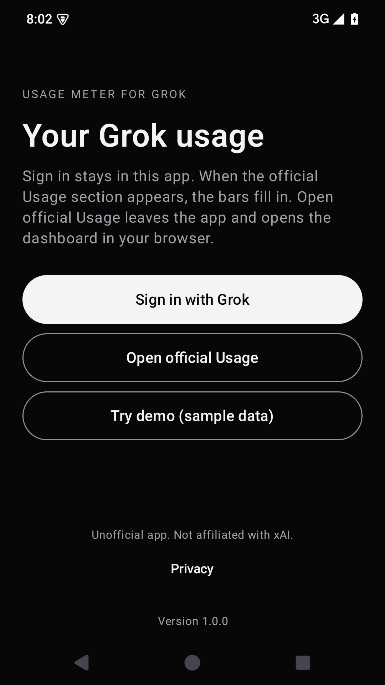
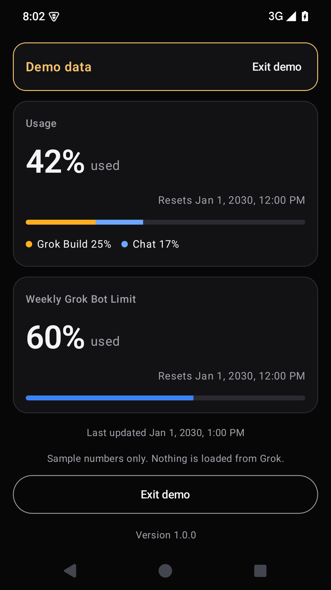
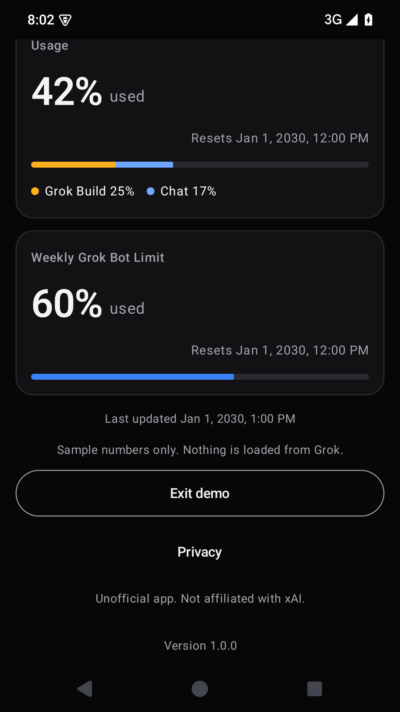

# Grok Usage

Unofficial English Android app that shows the usage bars from the official Grok dashboard: overall usage, the product breakdown, and the weekly Grok Bot limit.

It is not affiliated with xAI. It does not run a server and it does not invent a billing API. After you sign in, the app opens the official dashboard and reads the usage text that page already shows. The last numbers stay on the device so the screen still works offline.

Grok and xAI are trademarks of their owners.

## What you see

- Dark screen with two cards: Usage, and Weekly Grok Bot Limit.
- Large percent, a thin bar, the product legend, and the reset time on the right.
- A centered banner, such as `Usage 13% · Bot 65%`, when those cards are scrolled out of view. Tap it to return to the cards.
- Pull down to refresh.
- Last updated time, and a note that the data comes from the official Grok dashboard.
- Links to official Usage, billing and invoices, and legacy billing.
- Sign-in through the official Grok page.

The interface is English only.

<p>



</p>

## Requirements

- JDK 17 (`JAVA_HOME` pointing at a 17 install)
- Android SDK 36
- Android 9 or newer

## Run

```bat
gradlew.bat :app:testDebugUnitTest
gradlew.bat :app:assembleDebug
```

Install the debug APK from `app\build\outputs\apk\debug\app-debug.apk`.

On first open, tap **Sign in with Grok**. The official page opens in the app. When the Usage section is on that page, the bars fill in. **Open official Usage** is the separate action: it leaves the app and opens `https://grok.com/dashboard` in the browser. Google, X, and SpaceX account pages stay inside the app and do not cancel the sign-in. When a code or an account link finishes, the app opens Usage. The three-minute cancel applies only while the page is idle on the app's own sign-in screen.

Pull down on the cards to read the page again. **Sign out** deletes the saved numbers and the in-app cookies.

## Play Store bundle

The upload key stays on this machine. `keystore.properties` and `upload-keystore.jks` are gitignored. Copy `keystore.properties.example` if you are setting up another computer, and keep a backup of the keystore. Losing it means you cannot ship an update to the same Play listing.

```bat
gradlew.bat :app:bundleRelease
gradlew.bat :app:assembleRelease
```

- Play upload: `release\grok-usage-1.0.0.aab`
- Signed APK: `release\grok-usage-1.0.0.apk`

Create the Play app with package name `ch.castellon.grok.usage`. Turn on Play App Signing and upload the AAB. Use this privacy policy URL after the repo is public:

https://github.com/antonio-castellon/grok-usage/blob/main/PRIVACY.md

Data safety: the developer does not collect data. Usage text is stored only on the device. Sign-in loads grok.com inside the app under the user's own login. There is no analytics SDK.

## Tests

Parser and banner tests live in `app/src/test`. They cover the official wording (`13% used`, `Grok Build 9%`, `Weekly Grok Bot Limit`) and they reject a sign-in page.

A debug build can show the sample cards without a session:

```bat
adb shell am start -n ch.castellon.grok.usage/.MainActivity --ez preview true
```

Add `--ez previewScroll true` to open the screen scrolled to the billing links, which shows the banner. Release builds ignore both flags.
